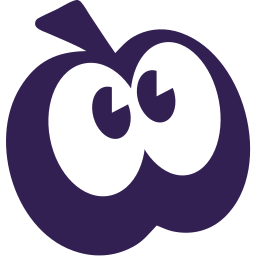
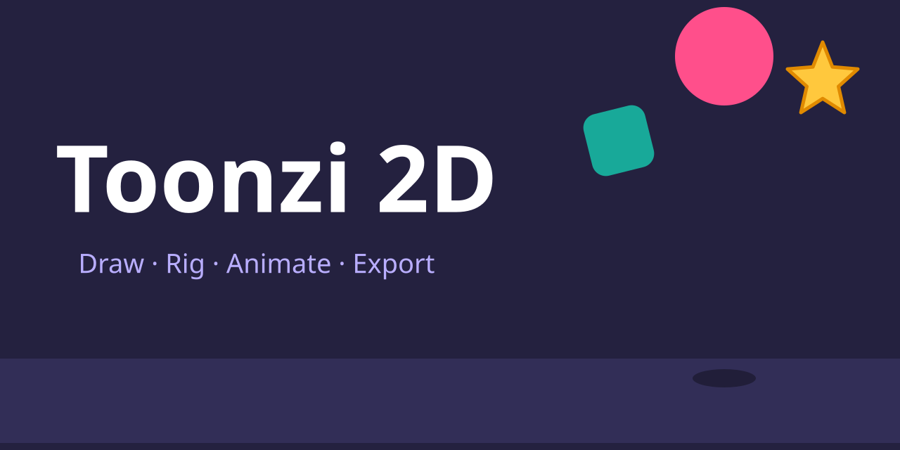

<p align="center"></p>

# Toonzi 2D

**Draw, rig, animate and export 2D animation in your browser. No install, no build step, nothing uploaded.**

<!-- TOONZI: hero animation. An animated SVG made in Toonzi 2D (Export > SVG animation).
     Replace docs/media/hero.svg with your own file; how: docs/media/README.txt -->
<p align="center">
  
</p>

<p align="center">
  <a href="#quick-start">Quick start</a> ·
  <a href="#what-it-can-do">Features</a> ·
  <a href="docs/index.html">Documentation</a> ·
  <a href="tutorials/README.md">Tutorials</a> ·
  <a href="CHANGELOG.md">Changelog</a> ·
  <a href="LICENSE">AGPL-3.0 license</a>
</p>

Toonzi 2D is a complete 2D animation tool written in plain JavaScript. Draw frame by frame or with vectors, set keyframes, build bone rigs, add physics, then export to video, SVG, Lottie, Rive, Unity, Godot, Blender and more. It has built-in tutorials taught by a little guide character.

## What it can do

**Draw**

- Freehand brushes (with a brush editor, stabilizer, pressure and mirror drawing), eraser, fill bucket, fill brush, gradients, and the Smooth, Width and Pull tools to reshape lines.
- Vector drawing with the Pen and the Points tool: curves, handles, shapes, text.
- Import SVG, PSD, Illustrator/PDF, images, video and audio. Record your voice.

**Animate**

- **Frame by frame:** a frames bar, onion skin, hold lengths, and Loop, Play once, Ping-pong or Hold playback.
- **Keyframes:** Auto key, Record motion, motion paths, and easing (Smooth, Speed up, Slow down, Overshoot, Bounce, Elastic, Hold, or your own curve).
- **Timeline editing:** every layer is a clip you can move, trim and cut. Shots, groups and several screens on one board.

**Rig and move things**

- **Rigs and bones:** draw bones, pose them (with IK), attach layers or bend them with the rig, paint weights (Paint weights, Gradient, Lasso, Goal curve), smooth bending with segmented bones, Rig lock, and several actions per rig (like walk and run) with action strips.
- **Controllers:** record how a layer looks at a few spots of a knob, then move the knob. Design your own controllers.
- **Constraints:** Follow, Move toward, Look at, Copy position, rotation or scale.
- **Physics:** bodies that fall and bounce, surfaces to land on, things that hang from a bone.

**Look**

- 40 built-in effects and transitions (Glow, Drop shadow, Blur, Pop in, Slide in, Wipe, Typewriter, Break apart...), plus an effect designer and a transition designer, and effects as code.
- Masks (show inside or outside a shape), blend modes, gradients.

**Interactive**

- Rules in plain words (WHEN something happens, IF conditions hold, DO actions) with a live Preview, exported as an interactive web page or a Rive file.

**Export** (logo menu at the top left › Export…, all done on your device)

| Export as | What you get |
|---|---|
| Video | MP4, WebM, MOV or MKV, with sound |
| Sprite sheet | One image (PNG, JPG, WebP, AVIF or SVG) plus a JSON file for Phaser, PixiJS and similar |
| Images (ZIP) | Every frame as PNG, JPG, WebP or AVIF |
| SVG animation | An animated SVG that plays by itself (this is what the hero above is) |
| Interactive | HTML (a web page that plays everything), Rive (.riv with a state machine), or SVG (click or hover to play) |
| Game Engine | Unity (.unitypackage) or Godot 4 (project folder), with bones, masks and one animation per screen or rig action |
| Blender (FBX) | Planes, a skeleton and the animation, one file per screen or rig action |
| Lottie (web) | A Lottie JSON file, with a web page that plays it |

**Learn**

- 15 built-in tutorials in the app (logo menu › Tutorials…) with a guide character, **Pip** or **Mo**, who points at what to click and checks what you did.
- A **tutorial maker** (Settings › Project › Tutorial maker…) to record and write your own.

## Quick start

Toonzi 2D runs in the browser. You need a modern browser; Chrome or Edge are best (video export uses WebCodecs, which Chromium has).

**Just open it.** Download or clone the repository and double-click `index.html`. Drawing, animating, tutorials, examples and most exports work straight from the folder.

**Or serve the folder** (recommended):

```bash
python3 -m http.server 8000      # then open http://localhost:8000
# or
npx serve
```

> **Why a server?** Opened from disk (`file://`), everything works except **Export as › Interactive › HTML**. That export packs the app's own files into one page, and browsers do not let a page from a file read other files. Serve the folder and it works. (Checked in Chromium: from `file://` the app, tutorials, examples and the SVG export run, while the HTML export reports that it can't read `css/app.css`.)

**Offline notes.** The app loads its fonts from Google Fonts; offline it falls back to system fonts. The Lottie and Rive web pages it exports load the Lottie and Rive players from a CDN, and importing Illustrator/PDF files loads pdf.js from a CDN. Everything else is local.

Your work is autosaved in the browser. Use **Save project** (Ctrl+S) to get a `.json` file with everything in it, and **Open project…** to load it.

### First steps
1. Click the logo at the top left, choose **Tutorials…** and start with **Drawing: brush and eraser**, **Frame by frame** and **Keyframes and tweens**.
2. Or pick **Examples** from the same menu and press Space to play.
3. Press **F** for the big stage. The small **?** buttons explain a panel.

## Documentation

[`docs/index.html`](docs/index.html) explains every tool and feature with short steps for beginners: the toolbar, timeline, layers, masks, effects, rigs, controllers, physics, interactive mode, every export format, settings and shortcuts. It is one self-contained page that works offline.

### Run the docs on GitHub Pages
1. Push the repository to GitHub.
2. Go to **Settings › Pages**. Under **Build and deployment**, choose **Deploy from a branch**, select your main branch and the **/ (root)** folder, and save.
3. After a minute the app runs at `https://<your-name>.github.io/<repo>/` and the docs at `https://<your-name>.github.io/<repo>/docs/`. Because the site comes from a web server, **Interactive › HTML** export works there too.
4. Put your Pages link here: <!-- TOONZI: replace with your Pages URL --> `https://<your-name>.github.io/<repo>/docs/`

Choose **root**, not the `/docs` folder: the docs link to the app and to the examples next to it. The empty `.nojekyll` file tells Pages to serve the files as they are.

## Put your own animations in this README and the docs

A GitHub README cannot run JavaScript, but it can show an **animated SVG** in an ``, and Toonzi 2D exports exactly that.

1. Make an animation in the app. Open the logo menu › **Export…**, set **Export as** to **SVG animation**, keep **Loop** on, and export.
2. Save the file in [`docs/media/`](docs/media/README.txt) as `hero.svg` (or another name).
3. In this README, each slot is marked with a comment like `<!-- TOONZI: hero animation -->` followed by an ``. Change the file name there to use a new file.

The docs page **can** run JavaScript, so it can show interactive exports. Export **Interactive › HTML**, save it in `docs/media/`, and add it to the marked section of `docs/index.html` (`<!-- TOONZI: interactive demos -->`) as an `<iframe>`. Full steps, and every export menu name, are in [`docs/media/README.txt`](docs/media/README.txt).

The app has no GIF export. Animated SVG is the format for READMEs.

## Project structure

```
index.html            loads everything in order (read it top to bottom)
css/app.css           all styles; colors and sizes are tokens at the top
vendor/               mediabunny (video writer), polygon-clipping (shape math)
js/core/              helpers, state + undo, layer tree, keyframes, matrices, icons
js/render/            bezier paths, brush strokes, fill bucket, scene renderer
js/model/             frames, object types, editing commands, screens, targets, templates
js/effects/           effect engine and the effect library
js/rig/               bones, physics, controllers + constraints, saved objects, actions
js/tools/             select, brush/eraser/fill, pen/points, cut, mirror, motion path
js/ui/                stage, board, timeline, inspector, menus, shortcuts, settings, interactions
js/io/                import (SVG, PSD, PDF, media), export (all formats), project files
js/tours/             the tutorial player and the tutorial maker
js/example.js         the built-in example project
js/app.js             start-up
examples/             example projects and objects (listed in examples/index.js)
tutorials/            tutorial files, guide characters, config.js (see tutorials/README.md)
docs/                 the documentation page and the animations shown in it
CHANGELOG.md          the long development history, round by round
```

Everything hangs off one global, `SB`. Every file starts with a comment that says what it does.

## Add a tutorial

Tutorials are plain files in `tutorials/`, and you don't need to touch the app's code.

- Make one in the app: **Settings › Project › Tutorial maker…**, then **⋯ › Save as a file for the tutorials folder**.
- Put the file in `tutorials/my-tutorials/` and add its path to `files` in `tutorials/config.js`.
- You can also add new guide characters (animated SVG, one picture per mood) and change the groups and the order.

All of it is explained in [`tutorials/README.md`](tutorials/README.md). Open `tutorials/preview.html` to see every guide in every mood.

## Contributing

Contributions are welcome: bug fixes, new tutorials, new effects, new export targets, docs.

- **No build step.** Edit a file, reload `index.html`. Files are classic scripts (no modules, no bundler), each wrapped as `(function (SB) { ... })(window.SB)` with `'use strict'`, and listed in `index.html` in load order. A new file needs a `<script>` line there.
- **Keep the style.** Start each file with a comment saying what it does. Keep plain JavaScript, and short names in the style of the file you are in.
- **Where things plug in:**
  - an effect: `SB.effect({...})` in `js/effects/library.js`
  - a tool: `SB.tools.add({...})` (see `js/tools/draw.js`)
  - an object type: `SB.types.add({...})` (see `js/model/types/`)
  - an import format: `SB.importers.add({...})` in `js/io/import.js`
  - an export format: an entry in `KINDS` and `RUN` in `js/io/export.js`
  - a shortcut: a line in `ACTIONS` in `js/ui/keys.js`
  - the look: the tokens at the top of `css/app.css`
- **Test by using it.** Open the app, try your change, and also try it on a phone-sized window. Check the browser console for errors.
- **Pull requests:** keep them small and say what you changed and why. Add a line to `CHANGELOG.md`, and update `docs/index.html` if a button or tool changed.
- **Bugs and ideas:** open an issue with the steps to repeat it and the browser you used.

## License

Toonzi 2D is free software under the **GNU Affero General Public License v3.0 or later** ([LICENSE](LICENSE)). Copyright (c) 2026 Toonzi 2D contributors.

In short (the license text is what counts):
- You can use Toonzi 2D for anything, including commercial work. **The animations you make are yours**: the license covers the app's code, not what you create with it.
- You can share it, change it and build on it.
- **If you change the app and share it, or run your changed version on a website or server for others to use, you must release your changed source code under the same license**, free for everyone to use and change. That keeps every version of Toonzi 2D open.

Files in `vendor/` keep their own licenses (mediabunny is MPL-2.0, polygon-clipping is MIT); both can be used inside an AGPL project.
